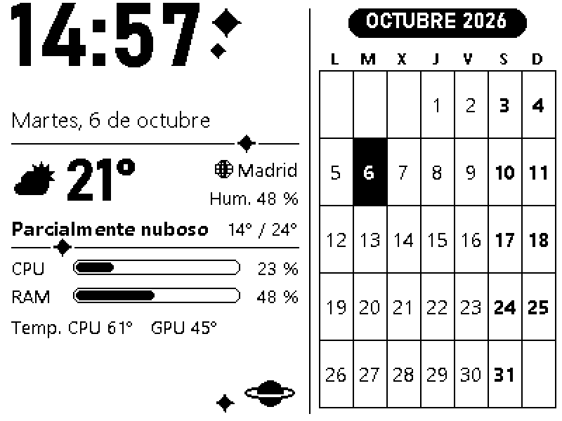
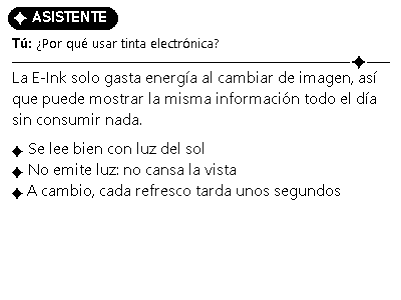
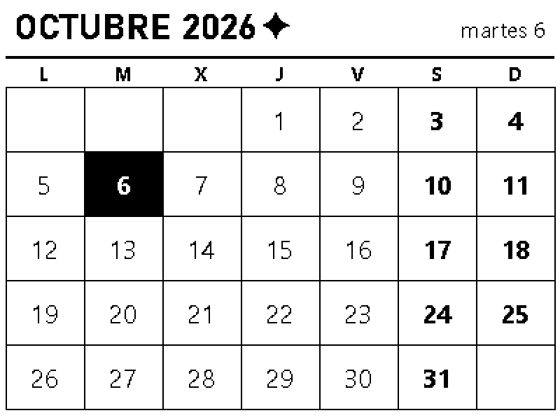

# E-Ink Assistant

**Una pantalla de tinta electrónica para el escritorio, controlada desde tu PC con Windows.**
Muestra la hora, el tiempo, el estado del ordenador y el calendario, y hace de "segunda pantalla"
para Claude: las respuestas del asistente aparecen en la E-Ink, sin luz y sin distraer.

<p align="center">
  
  
</p>

## Cómo funciona

El PC hace todo el trabajo y la pantalla es lo más simple posible:

```
 PC con Windows ─────────── USB o Wi-Fi ───────────► ESP32-C3 ──SPI──► E-Ink 4,2" 400×300
 (programa en la bandeja:                            (solo recibe imágenes
  dibuja las vistas, IA,                              y las muestra)
  servidor para Claude Desktop)
```

- **El programa de escritorio** vive en la bandeja del sistema, genera cada vista como una imagen
  de 400×300 en blanco y negro y la envía al ESP32 por USB o por Wi-Fi.
- **El ESP32** (firmware de Arduino) solo recibe esas imágenes y refresca la pantalla.

## Qué hace

- **Vista principal**: hora, fecha, tiempo actual ([Open-Meteo](https://open-meteo.com), sin
  registro), uso de CPU/RAM, temperaturas y el calendario del mes. Se actualiza sola cada pocos minutos.
- **Asistente con Claude**:
  - **Desde Claude Desktop**: Claude escribe en la pantalla cuando se lo pides (o siempre, si activas
    la opción), a través de un servidor MCP incluido. No necesita clave de API.
  - **Desde el propio programa**: escribe una pregunta y la respuesta aparece en la E-Ink, paginada.
    Este modo usa la API de Anthropic y necesita una clave.
- **Calendario** del mes a pantalla completa.
- **Atajos de teclado globales**:
  - Ctrl+Alt+← →: vista anterior/siguiente.
  - Ctrl+Alt+F1…F4: ir a una vista concreta.
  - Ctrl+Alt+Re Pág/Av Pág: pasar las páginas del asistente.
- **USB o Wi-Fi**: por cable sin configurar nada, o por Wi-Fi para dejar la pantalla con solo un
  cargador.
- **Refresco parcial inteligente**: los cambios pequeños, como la hora, se refrescan rápido; los
  cambios de vista hacen un refresco completo para no dejar "fantasmas".
- Modo **blanco sobre negro**, inicio con Windows, vista previa a tamaño real en la ventana.

<p align="center"></p>

## Instalación rápida

1. **Descarga** de la página de [**Releases**](https://github.com/PatolokoPato/eink-assistant/releases/latest):
   - `EInkAssistant-Setup-x.y.z.exe`: el instalador del programa para Windows 10/11 (64 bits).
   - `esp32_eink-c3-usb-x.y.z.bin`: el firmware para el ESP32-C3, versión USB.
2. **Monta el hardware**: un ESP32-C3 SuperMini y una pantalla WeAct Studio de 4,2". Son 8 cables
   (ver la guía).
3. **Graba el firmware** desde el navegador, sin instalar nada.
4. **Instala el programa** y elige la vista que quieras.

👉 **[Guía de instalación paso a paso](docs/instalacion.md)**: hardware, cableado, firmware,
programa, Wi-Fi y conexión con Claude Desktop.

## Hardware

| Pieza | Modelo probado |
|---|---|
| Pantalla | WeAct Studio 4,2" E-Paper, controlador SSD1683, variante **blanco/negro/rojo** |
| Microcontrolador | ESP32-C3 SuperMini (USB-C nativo) |
| Cables | 8 cables dupont hembra-hembra |

El firmware ya compilado de Releases es para exactamente esa combinación. Para la variante solo
blanco/negro de la WeAct, para otros paneles de 400×300 compatibles con
[GxEPD2](https://github.com/ZinggJM/GxEPD2) o para un ESP32 clásico, hay que cambiar
`firmware/esp32_eink/config.h` y compilarlo uno mismo (ver la guía).

## Para desarrolladores

Todo es Python 3.12+ en el PC y Arduino en el ESP32, con un protocolo binario sencillo entre
ambos. Hay tests con un ESP32 simulado, así que se puede desarrollar sin hardware.

- [Guía de desarrollo](docs/desarrollo.md): estructura del código, ejecutar desde el código
  fuente, tests y cómo generar el instalador.
- [Protocolo PC ↔ ESP32](docs/protocolo.md).

## Licencia

[MIT](LICENSE): puedes usarlo, modificarlo y compartirlo libremente, manteniendo el aviso de
copyright.
